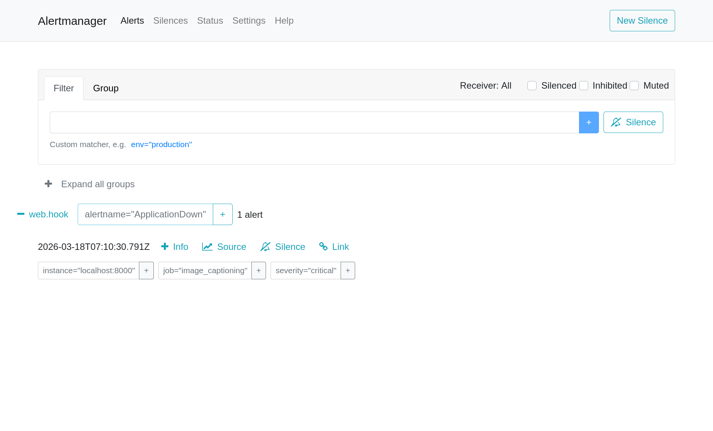
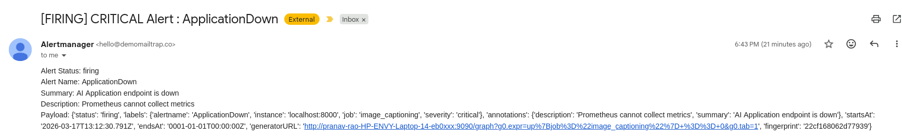

[](https://classroom.github.com/a/4_UXI9cp)

# Image Captioning & Monitoring

- Name: Pranav Rao
- Roll No: DA25M022

In this Assigment, we perform a simple Image Captioning task using nlpconnect/vit-gpt2-image-captioning using the Streamlit web app. We then monitor its health for any problems and performance using Prometheus and visualize it using Grafana. Honcho is used as a Process Manager for orchaestrating all of the modules:
1. node-exporter
2. alert-manager
3. prometheus
4. mail_server
5. streamlit app
6. grafana


To run the repo:
```./run.sh > prog_log.log 2>&1```

Software requirements:
1. prometheus-3.10.0.linux-amd64
2. node_exporter-1.10.2.linux-amd64
3. alertmanager-0.31.1.linux-amd64
4. grafana-enterprise_12.4.1_22846628243_linux_amd64.deb
5. Run ```pip install requirements.txt```
Replace the default yaml files with the present ones

Video Link: https://drive.google.com/file/d/1QvX6BMLFTyZnnOfGrJYE7cYMt0HTiCK8/view?usp=sharing

Alert Mail: 
Alert Mail: 


Repo Structure:
```
.
├── A5.pdf
├── alert_mail.png
├── alertmanager-0.31.1.linux-amd64
│   ├── alertmanager
│   ├── alertmanager.yml
├── config.yaml
├── dashboard.json
├── data
│   ├── sample
│   │   ├── dog.jpeg
│   │   ├── himalaya_mess.jpeg
│   │   ├── Niels_Bohr.jpg
│   │   └── sample.zip
├── grafana-enterprise_12.4.1_22846628243_linux_amd64.deb
├── node_exporter-1.10.2.linux-amd64
│   ├── node_exporter
├── Procfile
├── prog_log.log
├── prometheus-3.10.0.linux-amd64
│   ├── alerts.yaml
│   ├── prometheus
│   ├── prometheus.yml
├── README.md
├── requirements.txt
├── run.sh
├── src
│   ├── app.py
│   ├── inference.py
│   ├── mail.py
```